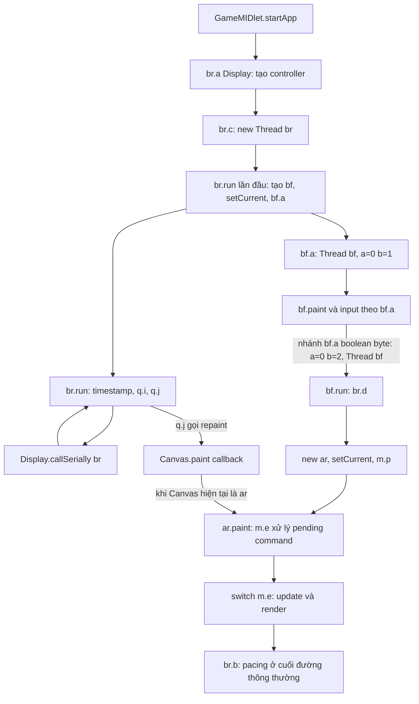

# Tổng quan kiến trúc game — v2.1.2

Khảo sát tĩnh Milestone 1, ngày **2026-10-21**. Entry point là `rpg.GameMIDlet`; `br` khởi động một Thread rồi tự xếp lịch qua `Display.callSerially(this)`. Canvas ban đầu là `bf`, sau đó có đường chuyển sang `ar`. `ar.paint(Graphics)` chứa cả xử lý transition, update và render.

**JAR:** `original/heroes-lore-v2.1.2.jar`, 554715 byte. **SHA-256:** `7eb032297967f5d8382cc4f1ab5c3016459e01b235b42a3b88c6a8bfe46c5f61`, khớp `original/SHA256.txt` và kết quả `REA.open_binary`.

## Nguồn và cách đọc kết luận

- **Bằng chứng artifact:** REA MCP 6.7.0 xác nhận identity và inventory ZIP; chưa cung cấp call graph hay decompilation J2ME. Xem [baseline REA](../rea-evaluation/baseline.md).
- **Bằng chứng source:** đọc output JADX có sẵn bằng `rg`, `nl -ba`, `sed`; phiên này không chạy lại JADX. Mọi vị trí `*.java:dòng` bên dưới thuộc `reverse-engineering/decompiled/sources/`. Tên `fNNNa`, `mNNNa` là alias do JADX xử lý collision; `defpackage/` là cách JADX biểu diễn các class ở default package trong JAR.
- **Đối chiếu bytecode:** `javap 21.0.12.1 -c -p -s` trực tiếp trên JAR cho bảy class `rpg.GameMIDlet`, `ar`, `bf`, `br`, `bt`, `q`, `m`. Công cụ này độc lập với REA. Bốn sai lệch control flow của JADX đã được ghi trong [FND-0001](../../reverse-engineering/findings/FND-0001-game-loop.md).
- **Suy luận** được ghi riêng; chưa có quan sát emulator/runtime, scenario hay số đo FPS. Không đặt tên mechanics từ tên class obfuscated hoặc state số.

Finding và log chi tiết: [FND-0001](../../reverse-engineering/findings/FND-0001-game-loop.md). Fingerprint source/class: [local-evidence.json](../../reverse-engineering/findings/evidence/milestone-1/local-evidence.json). Bảy `.class` trong `decompiled/resources/` khớp byte của các member tương ứng trong JAR; điều này không tự chứng minh source decompile chính xác.

## Sơ đồ đã xác minh tĩnh

Mũi tên `repaint → paint` biểu diễn yêu cầu và callback, không cam kết tỉ lệ 1:1 hay thứ tự callback trên một runtime cụ thể. Đường `bf → ar` có điều kiện, không khẳng định mọi lượt khởi động đều đi tới `ar`.

## Entry point và lifecycle

Manifest trong JAR khai báo `MIDlet-1: Heroes Lore, /icon.png, rpg.GameMIDlet`, `MIDP-2.0`, `CLDC-1.0` ([manifest đã lưu](../../reverse-engineering/findings/evidence/milestone-1/local-evidence.json)). Đây là đọc ZIP bằng Python, không phải phân tích manifest của REA.

| Class / method | Bằng chứng source đã đối chiếu `javap` | Vị trí source |
| --- | --- | --- |
| `rpg.GameMIDlet.<init>()` | Lưu singleton `a=this`; cờ `f289a` khởi tạo false | `rpg/GameMIDlet.java:15–19` |
| `startApp()` | Nếu đã start thì return; lần đầu đặt cờ, lấy `Display`, gọi `br.a(Display)` rồi `br.f168a.c()` | `rpg/GameMIDlet.java:21–30` |
| `pauseApp()` | Chỉ in `pauseApp` trong method này | `rpg/GameMIDlet.java:32–34` |
| `destroyApp(boolean)` → `a()` | Gọi `notifyDestroyed()`; không có cleanup khác trong hai method này | `rpg/GameMIDlet.java:36–42` |

Không suy ra việc pause/resume chỉ từ `pauseApp()`: Canvas có callback riêng. `ar.hideNotify()` ở state `2` gọi `keyReleased(-8)` rồi gửi command byte `13`; ở state `1` đổi trực tiếp sang state `15`. `ar.showNotify()` ở state `2` cũng gửi command `13` (`defpackage/ar.java:168–187`). `bf.hideNotify()/showNotify()` gọi `bv.a()/b()` (`defpackage/bf.java:242–248`); chưa phân tích nội dung `bv`.

## Canvas và khởi tạo

`q extends Canvas`; constructor bật fullscreen, lấy width vào `q.g`, tính `q.i=g/2` (`defpackage/q.java:8,20–25`). `bf extends q implements Runnable`, `ar extends q` (`defpackage/bf.java:8`, `defpackage/ar.java:9`).

`br.run()` lần đầu tạo `bf`, `Display.setCurrent(bf)`, gọi `bf.a()` (`defpackage/br.java:73–80`). `bf.paint()` gọi `q.m115a(graphics.getClipHeight())` (`defpackage/bf.java:122–123`); method này đặt `q.h` từ argument khi `<350`, hoặc từ `getHeight()` khi còn lại, rồi tính `q.j=h/2` (`defpackage/q.java:189–197`). Constructor `ar` dùng `q.g/q.h` để tính vùng vẽ (`defpackage/ar.java:52–65`). **Chưa xác minh:** callback thực tế có bảo đảm `q.h` hợp lệ trước khi tạo `ar` hay không.

`bf.a()` đặt mode nội bộ `a=0,b=1`, chuẩn bị language và tạo Thread (`defpackage/bf.java:199–218`). Nhánh `bf.a(boolean,byte)` được phép tiếp tục sẽ đặt `a=0,b=2` và tạo Thread; nhánh còn lại đặt `a=2` (`defpackage/bf.java:262–277`). `bf.run()` ở `a=0,b=2` gọi `bt.e()`, `cd.C()`, `br.d()`; `br.d()` tạo `ar`, lưu `f158a`, đổi Display, gọi `m.p()` (`defpackage/bf.java:110–116`; `defpackage/br.java:121–126`).

## Scheduler, worker và pacing

| Luồng / method | Hành vi được thấy | Vị trí source |
| --- | --- | --- |
| `br.c()` | `f=true; new Thread(this).start()` | `defpackage/br.java:116–119` |
| `br.run()` | Bootstrap một lần; trong lock `f167a`, return nếu `e`; ghi timestamp, `q.i()`, `q.j()`, rồi `Display.callSerially(this)` | `defpackage/br.java:73–90` |
| `q.i()` / `q.j()` | Hoàn tất release đang chờ / gọi `repaint()` | `defpackage/q.java:27–33,185–187` |
| `bf` workers | Các call site tạo Thread ở initialization, input mode `2`, nhánh chuyển Canvas | `defpackage/bf.java:51–56,199–218,262–277` |
| `bt.a()/b()/c()/d()` | Đặt mode `1/2/3/5`, khai báo progress rồi `new Thread(new bt()).start()` | `defpackage/bt.java:35–58` |

`br.a(int)` đặt target period bằng phép chia nguyên `1000/i`; `br.e()` dùng cấu hình `c`, `br.f()` dùng `5` (200 ms), `br.g()` dùng `20` (50 ms). Cấu hình ban đầu chọn index `2` trong `{8,10,14,18}`, tức `14` (71 ms), rồi bootstrap gọi `f()` (`defpackage/br.java:48,57–69,128–146`). Đây là target pacing, **không phải FPS đã đo**.

`br.a()` lấy `System.currentTimeMillis()`. `br.b()` bỏ qua pacing nếu `ag.f45a`; còn lại sleep phần thời gian thiếu hoặc yield nếu đã vượt target (`defpackage/br.java:93–114`). `bf.paint()` gọi pacing cuối method (`defpackage/bf.java:196`); `ar.paint()` gọi ở cuối đường thông thường (`defpackage/ar.java:153–155`), nhưng nhánh return sớm tại dòng `90` bỏ qua đoạn cuối. Không thấy fixed timestep accumulator trong các method scheduler/paint đã khảo sát.

**Suy luận kiến trúc:** Thread ban đầu đưa controller vào chuỗi callback tự xếp lịch; logic game không nằm trong một vòng `while` ở `br.run()`. Shared lock `br.f167a` bao quanh scheduler, `ar.paint`, input và các callback visibility của `ar`; chưa audit đầy đủ concurrency của workers.

## Update và render

`ar.paint(Graphics)` lấy lock và gọi `m.e()` trước `switch(m.e)` (`defpackage/ar.java:67–70`). Ở đây `m.e()` là method xử lý transition, còn `m.e` là field state `int`.

| State `m.e` | Thứ tự gọi trong `ar.paint()` | Vị trí source |
| --- | --- | --- |
| `1` | `bt.a(Graphics)`; method này chọn progress rendering theo mode của `bt` | `defpackage/ar.java:71–73`; `defpackage/bt.java:567–576` |
| `2` | `m.g()` → `m.i()` nếu `f162d=true`, ngược lại đảo thứ tự; kiểm tra lại state; tùy điều kiện gọi `m.a(true,true)`; render bằng `m.f269a.a(Graphics)` rồi `ar.a(Graphics)` | `defpackage/ar.java:74–92` |
| `4` | `m.j()`, kiểm tra lại state, `ag.m12b()`, `ag.a(Graphics)` | `defpackage/ar.java:94–100` |
| `5` | `ah.a().b()`, `c()`, `a(Graphics)` | `defpackage/ar.java:101–105` |
| `6/7/8` | Helper `ar.a(Graphics,ca)` rồi render `bo/aw/z` tương ứng | `defpackage/ar.java:106–117,158–165` |
| `9` | `be.a().c()` rồi `be.a().a(Graphics)` | `defpackage/ar.java:118–121` |
| `10` | Vẽ, giảm counter `f82e`; khi về 0 đổi state `1` và start `bt.d()` | `defpackage/ar.java:122–131` |
| `11–15` | Các nhánh vẽ riêng, giữ state số, chưa đặt nhãn mechanics | `defpackage/ar.java:132–151` |

Mở rộng sang **`m` duy nhất** vì các call trực tiếp từ `br`, `bt`, `ar`: `m.g()` tính offset (`defpackage/m.java:266–269`); `m.i()` gọi `q()` → `n()` → `f269a.b()` (`330–334`); `m.q()` áp dụng cặp byte chờ rồi reset (`340–347`); `m.n()` gọi các method cập nhật object (`467–475`); `m.j()` gọi `ag.m11a()` (`336–338`). Chưa mở rộng implementation `ad`, `an`, `ag`, `ah`, `be`, `bo`, `aw`, `z`, `bv`, `cd`; tên method/call site không đủ để xác nhận mechanics của chúng.

## Input và state transitions

`ar.keyPressed(int)` giữ lock, chuẩn hóa `±21→53`, `±22→-8`, bỏ input khi controller null hoặc cờ `br.e`; đặt `q.a=true`, gọi `getGameAction()` trừ mã `-8`, rồi dispatch theo `m.e` (`defpackage/ar.java:189–243`). State `2` dùng `ar.a(gameAction,keyCode)`; `4/5/6/7/8/9` chuyển tới `ag/ah/bo/aw/z/be`. Raw key `50/52/54/56` chuyển thành `m.b(byte)` với giá trị `1/3/4/2`; gameAction `1/2/5/6` có routing tương ứng (`defpackage/ar.java:268–340`). Chưa gán ý nghĩa gameplay cho các giá trị đó.

`ar.keyReleased(int)` chỉ xử lý state `2`. Nếu cờ `q.a` còn bật, nó lưu **một** key code trong `q.f`; lượt `br.run()` kế tiếp gọi `q.i()` để xóa cờ rồi gọi lại virtual `keyReleased(q.f)` (`defpackage/ar.java:245–265`; `defpackage/q.java:27–33`). Nhánh release còn lại gọi `m.h()` khi `m.m101a()==2`; `m.h()` lưu cặp pending `f277h/f278i` (`defpackage/m.java:313–316`). Đây là pending action riêng, không phải field state toàn cục `m.e`.

Phải phân biệt ba miền: mode `bf.a/b`, mode worker `bt.a`, và state toàn cục `m.e`. Ngoài ra **pending command** `m.f273b` khác state: `m.a(int)` đổi state ngay; các overload `m.a(byte...):void` chỉ lưu command cùng params `f274c/f275d/f276e` (`defpackage/m.java:117–143,271–273`). Method `m.e()` lấy/reset pending rồi dispatch; bytecode xác nhận return ngay khi pending bằng 0, dù JADX in block rỗng (`152–157`). Đây là một slot ghi đè, chưa thấy queue nhiều command trong các method này.

Các ví dụ transition có bằng chứng:

- `br.d()` → `m.p()`; cuối `m.p()` enqueue `(2,9,3)` → lần xử lý command `2` đặt state `9`, gọi `br.g()` (`defpackage/m.java:163–173,766–768`; bytecode `m.p()` offsets `286–290`).
- Input ở state `11` enqueue `(2,2,1)` → state `2`, gọi `br.e()` (`defpackage/ar.java:224–227`; `defpackage/m.java:163–173`).
- Visibility callback gửi **command `13`** → state **`5`**, gọi `ah.a().d()`; command `13` không đồng nghĩa state `13` (`defpackage/m.java:202–209`).
- Command `1` → state `1`, pacing `5`, worker `bt.b()`; worker mode `2` gửi command `15`, method `m.f()` cuối cùng gửi `(2,2,1)` (`defpackage/m.java:158–162,219–221,250–264`; `defpackage/bt.java:95–100`). Đây là chuỗi điều khiển tĩnh có điều kiện, chưa phải scenario runtime đã chạy.

## Phần còn chưa xác minh

Chưa chạy emulator để xác nhận callback ordering, số frame trên mỗi request, FPS, độ trễ input, visibility/resume và race giữa worker với Display. Chưa giải thích đường `bf.keyPressed()` đặt mode `a=3` rồi start Thread trong khi bytecode `bf.run()` chỉ xử lý `a=0` (`defpackage/bf.java:51–56,68–120`). Chưa có scenario tham chiếu nên không gán trạng thái “đã kiểm thử hành vi”.

Map/resource format, collision, save/load và mechanics vẫn ngoài kết luận của Milestone 1 này. Các call liên quan chỉ được ghi để nối kiến trúc, không được xem là đặc tả của những subsystem đó.

**Theo dõi M1.5, 2026-10-21:** [FND-0002](../../reverse-engineering/findings/FND-0002-runtime-verification.md) kiểm tra lại 4 sai lệch bằng `javap`, đính chính mô tả thiếu return ở command `21/2`, và ghi ảnh hưởng tới port. [Bộ scenario/protocol](../../reference/scenarios/README.md) đã được chuẩn bị; chưa launch emulator, 0/8 scenario đã chạy. Phần kiến trúc trên vẫn là kết luận tĩnh, chưa có số đo hoặc xác nhận runtime mới.

**Lượt tiếp tục cùng ngày:** [FND-0003](../../reverse-engineering/findings/FND-0003-emulator-smoke.md) đã xác minh FreeJ2ME-Plus 1.52 chạy trên WSLg, quan sát startup/menu/gameplay và đường từ giường ra ngoài nhà. 5/8 scenario có quan sát một phần (thêm input trong nhà và cold save/load), chưa có scenario đạt toàn bộ. Bằng chứng mới gồm ảnh, console, config, input tổng hợp và snapshot; chưa phải trace ordering/BCI hoặc số đo FPS, nên không dùng chúng để xác nhận toàn bộ sơ đồ kiến trúc tĩnh trên.
